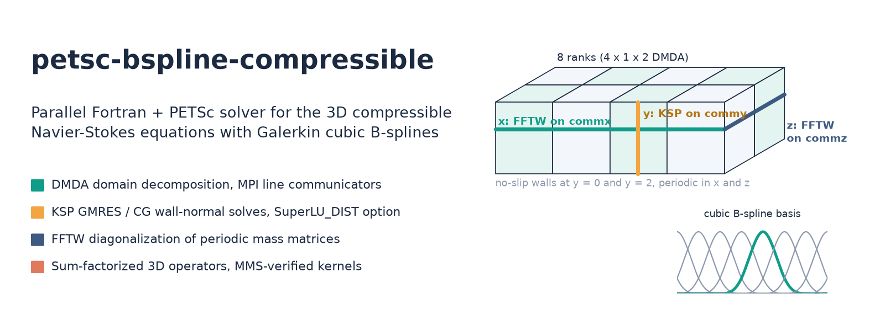
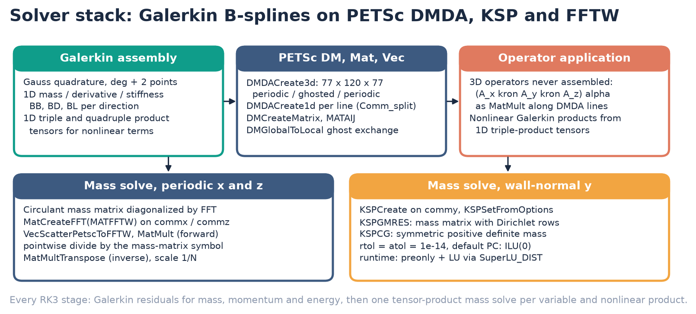
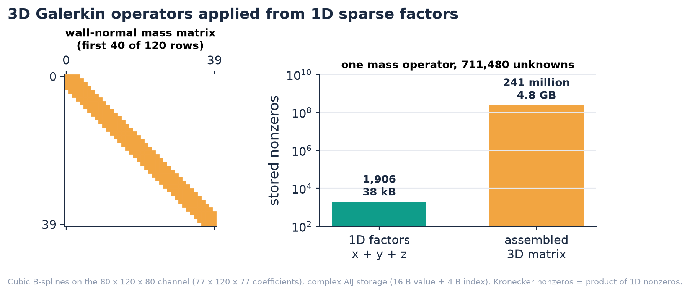
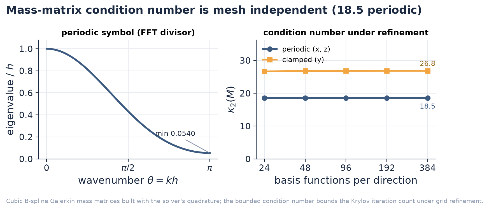

<p align="center"></p>

<p align="center">
  <a href="LICENSE"></a>
  
  
  
</p>

# petsc-bspline-compressible

Parallel Fortran + PETSc solver for the 3D compressible Navier-Stokes
equations, discretized with a Galerkin (finite element) method on cubic
B-splines and distributed over MPI with PETSc DMDA.

## Overview

- **Matrix-free 3D operators from 1D sparse factors.** Every 3D Galerkin
  operator is a Kronecker product of 1D sparse AIJ matrices and is applied
  line by line with `MatMult`. On the 80 x 120 x 80 channel (711,480 unknowns)
  the mass operator is stored as **1,906 nonzeros (38 kB)**; the assembled 3D
  matrix would hold **241 million nonzeros (4.8 GB)**.
- **Directional mass inversion with PETSc and FFTW.** The tensor-product mass
  matrix is inverted one direction at a time: parallel FFTW transforms
  (`MatCreateFFT`, `MATFFTW`) diagonalize the circulant periodic matrices in x
  and z, and PETSc KSP solves the wall-normal systems with **GMRES** (Dirichlet
  rows) and **CG** (SPD mass matrix), or with **SuperLU_DIST** sparse direct LU
  selected at run time.
- **Mesh-independent conditioning.** The 1D cubic B-spline mass matrices have
  spectral condition number **18.5** (periodic) and **26.8** (clamped,
  wall-normal) at every resolution, so Krylov iteration counts stay bounded as
  the grid is refined.
- **MPI domain decomposition.** A 3D DMDA splits x and z across ranks; three
  families of 1D DMDAs on `MPI_Comm_split` line communicators share its
  ownership ranges, so FFTs, Krylov solves and operator applications act on
  each rank's lines with no data redistribution.
- **Verification by manufactured solutions.** Each discrete operator (mass
  solves, triple and quadruple Galerkin products, divergence, skew-symmetric
  convection, viscous stress, energy terms, full right-hand side) is checked
  against an exact manufactured solution in `tests/test_operators.f90`.

## Results

<p align="center"></p>

**Figure 1.** Solver stack. Galerkin integrals are assembled into 1D PETSc
`Mat` objects on DMDA line communicators; 3D operators are applied as
Kronecker products; the mass matrix is inverted by FFTW in the periodic
directions and by PETSc KSP (GMRES / CG, or SuperLU_DIST) in the wall-normal
direction.

<p align="center"></p>

**Figure 2.** Left: sparsity of the wall-normal cubic B-spline mass matrix
(bandwidth 7). Right: nonzeros stored for one mass operator on the 77 x 120 x 77
coefficient grid, as three 1D factors versus an assembled 3D matrix.

<p align="center"></p>

**Figure 3.** Left: eigenvalues of the periodic cubic Galerkin mass matrix as a
function of wavenumber; this symbol is the divisor applied in Fourier space by
the FFTW solve, with minimum 272/5040 = 0.054 at the grid Nyquist mode.
Right: condition number of the periodic and clamped 1D mass matrices from 24
to 384 basis functions.

All three figures are regenerated by `python tools/make_readme_assets.py`.

## Method

The non-dimensional continuity, momentum and temperature equations are
advanced in skew-symmetric convective form,

$$
\frac{\partial \rho}{\partial t} = -\frac{\partial (\rho u_j)}{\partial x_j},
$$

$$
\frac{\partial u_i}{\partial t} = -\frac{1}{2\rho}\left[\rho u_j \frac{\partial u_i}{\partial x_j}
+ \frac{\partial (\rho u_j u_i)}{\partial x_j} - u_i \frac{\partial (\rho u_j)}{\partial x_j}\right]
- \frac{1}{\gamma M^2 \rho}\frac{\partial (\rho T)}{\partial x_i}
+ \frac{1}{Re\,\rho}\frac{\partial \tau_{ij}}{\partial x_j} + f_i,
$$

$$
\frac{\partial T}{\partial t} = -\frac{1}{2\rho}\left[\rho u_j \frac{\partial T}{\partial x_j}
+ \frac{\partial (\rho u_j T)}{\partial x_j} - T \frac{\partial (\rho u_j)}{\partial x_j}\right]
- (\gamma-1) T \frac{\partial u_j}{\partial x_j}
+ \frac{\gamma(\gamma-1)M^2}{Re\,\rho}\tau_{ij}\frac{\partial u_i}{\partial x_j}
+ \frac{\gamma}{Re\,Pr\,\rho}\frac{\partial^2 T}{\partial x_j \partial x_j},
$$

with $P = \rho T / (\gamma M^2)$, viscosity $\mu$ evaluated at the mean
temperature, and a streamwise body force $f_i$ that balances the wall shear
stress and drives the channel.

- **Discretization.** Each field is a tensor-product cubic B-spline expansion
  $q(x,y,z,t) = \sum \alpha_{ijk}(t) B_i(x) B_j(y) B_k(z)$, periodic in x and z
  and clamped at the walls in y. Galerkin projection with exact Gauss quadrature
  (p + 2 points per knot span) gives $M\,\dot{\alpha} = r(\alpha)$ with
  $M = M_x \otimes M_y \otimes M_z$.
- **Nonlinear terms.** Products such as $\rho u_i$, $\rho u_i u_j$ and
  $\rho u_j T$ are projected onto the spline space with precomputed 1D
  triple- and quadruple-product tensors $\int B_a B_b B_c$, then each product
  is obtained from one mass solve.
- **Linear algebra.** $M^{-1}$ is applied as $M_x^{-1}$, $M_y^{-1}$,
  $M_z^{-1}$ along DMDA lines: FFT, pointwise division by the transformed
  mass-matrix column and inverse FFT in x and z; a KSP solve in y.
- **Time integration.** Low-storage three-stage third-order Runge-Kutta, with
  one tensor-product mass solve per variable per stage.
- **Case.** Compressible turbulent channel, $L_x \times L_y \times L_z =
  4\pi \times 2 \times 4\pi/3$, $M = 1.5$, $Re = 3000$, $Pr = 0.72$,
  $\gamma = 1.4$, isothermal walls, 80 x 120 x 80 spline grid, laminar
  Poiseuille profile plus 10% random perturbation as initial condition.

### Where things live

| Component | File | Routines |
|---|---|---|
| MPI / PETSc initialization | `src/environment.f90` | `environment_init`, `environment_free` |
| 3D DMDA, line communicators (`MPI_Comm_split`), 1D DMDAs | `src/lattice.f90` | `lattice_init`, `grid_init` |
| Knot vectors, B-spline basis and derivatives | `src/bspline.f90` | `bspline_init`, `xBJK`, `ydBIJK` |
| Gauss-Legendre rules, element quadrature | `src/gausstable.f90`, `src/quad.f90` | `gauss_init`, `quad_y_BB`, `quad_x_BBB` |
| 1D Galerkin mass, derivative, stiffness `Mat` (AIJ) | `src/operator.f90` | `mass_y`, `linear_x/y/z` |
| 1D triple / quadruple product tensors | `src/operator.f90` | `nonlinear_x/y/z` |
| KSP setup (GMRES, CG) and directional mass solve | `src/linalg.f90` | `ksp_init`, `ksp_solve` |
| FFTW diagonalization of periodic mass matrices | `src/linalg.f90` | `fft_init_x/z`, `fft_solve_x/z` |
| Kronecker-product operator application | `src/linalg.f90` | `matvec`, `d1dx` ... `dxdz` |
| Skew-symmetric convection, pressure, viscous, energy terms | `src/linalg.f90` | `convection`, `pressure`, `viscous`, `energy` |
| Galerkin load vectors and Navier-Stokes residuals | `src/rhs.f90` | `rhs_init_separable`, `rhs_mass`, `rhs_momentum`, `rhs_energy` |
| RK3 coefficients | `src/rk.f90` | `rk_init` |
| Gather to rank 0 (natural ordering), output | `src/output.f90` | `io_fortran_scatter`, `io_fortran_write` |
| Manufactured solutions and exact operators | `src/mms.f90`, `src/error.f90` | `Linf_eval_xyz`, `compute_sol_*` |
| Channel-flow driver | `app/channel_flow.f90` | `channel_flow` |
| Manufactured-solution checks | `tests/test_operators.f90` | `run_test` |

## Solver stack

| PETSc / MPI object | Role | Settings in code |
|---|---|---|
| `DMDACreate3d` | distributed coefficient array, ghost exchange (`DMGlobalToLocal`) | 77 x 120 x 77, periodic / ghosted / periodic, box stencil width 6, `PETSC_DECIDE x 1 x PETSC_DECIDE` ranks |
| `MPI_Comm_split` + `DMDACreate1d` | x, y, z line communicators sharing the 3D ownership ranges | stencil width 3 |
| `DMCreateMatrix` (`MATAIJ`) | 1D Galerkin mass, derivative, stiffness matrices | `MatSetValue` + `MatAssembly` |
| `MatCreateFFT` (`MATFFTW`) | periodic mass inversion in x and z | `VecScatterPetscToFFTW`, `MatMult`, `MatMultTranspose` |
| `KSP` (`KSPGMRES`) | wall-normal mass matrix with Dirichlet rows | `rtol = atol = 1e-14`, `KSPSetFromOptions` |
| `KSP` (`KSPCG`) | wall-normal SPD mass matrix | `rtol = atol = 1e-14`, `KSPSetFromOptions` |
| `PC` | ILU(0) by default; LU / Cholesky through SuperLU_DIST at run time | `-pc_type lu -pc_factor_mat_solver_type superlu_dist` |

Full option list: [`docs/solver-options.md`](docs/solver-options.md). Ready-made
options files: [`examples/options/`](examples/options).

## Verification

`tests/test_operators.f90` holds one manufactured-solution check per discrete
operator. Each check projects separable trigonometric fields such as
$\cos 4x \,\sin 4y \,\cos 4z\, e^{-t}$ onto the spline space, applies the
operator through the same PETSc code path as the solver, inverts the mass
matrix, and prints the max-norm error against the exact result.

| `-test` | Operator checked |
|---|---|
| `linearsolve_x`, `linearsolve_y`, `linearsolve_z`, `linearsolve_xyz` | 1D FFTW / KSP mass solves and the full tensor-product solve with wall Dirichlet data |
| `nonlinear_x/y/z`, `nonlinear_sum_BBB`, `nonlinear_sum_BBBB` | Galerkin triple and quadruple products |
| `reciprocal_1d`, `reciprocal_3d`, `reciprocal` | projection of $1/\rho$ |
| `divergence`, `nonlinear_divergence` | $\partial(\rho u_j)/\partial x_j$ |
| `convection` | skew-symmetric convection term |
| `viscous`, `energy_viscous` | viscous stress and viscous heating |
| `momentum_energy`, `rhs`, `nonlinear_combined_rhs` | assembled momentum and energy right-hand sides |
| `rk` | RK3 integration of an ODE with known solution |
| `interpolate_1d`, `interpolate_3d` | evaluation of spline fields at arbitrary points |

One command builds everything and runs the core checks on 4 MPI ranks:

```bash
PETSC_DIR=/path/to/petsc PETSC_ARCH=linux-gnu-complex-opt scripts/verify.sh
```

Each check prints `test: <name>` followed by its max-norm error. The same
checks are registered with CTest (`ctest --test-dir build`).

## Layout

```
petsc-bspline-compressible/
├── CMakeLists.txt              build (PETSc via PETSC_DIR / PETSC_ARCH, MPI Fortran)
├── src/                        solver library (13 Fortran modules)
├── app/channel_flow.f90        compressible turbulent channel driver
├── tests/test_operators.f90    manufactured-solution checks (CTest)
├── examples/options/           PETSc options files: Krylov, SuperLU_DIST, profiling
├── benchmarks/                 strong-scaling script from -log_view
├── scripts/                    PETSc install, one-command verify, output reader
├── docs/solver-options.md      PETSc KSP / PC / DM options used by the solver
├── tools/make_readme_assets.py figure generation
└── assets/                     README figures
```

## Building

Requirements:

- gfortran (GCC 7 or newer) and an MPI implementation (MPICH or Open MPI)
- CMake 3.13 or newer, pkg-config
- PETSc 3.10.x configured with complex scalars, FFTW, SuperLU_DIST and
  METIS/ParMETIS

`scripts/install_petsc.sh` builds that PETSc configuration (downloading FFTW,
SuperLU_DIST, METIS and ParMETIS, or using existing installs from
`SUPERLU_DIST_ROOT` / `PARMETIS_ROOT`):

```bash
MPICC=mpicc MPIF90=mpif90 scripts/install_petsc.sh $HOME/opt/petsc opt
export PETSC_DIR=$HOME/opt/petsc/linux-gnu-complex-opt
export PETSC_ARCH=
```

Build the library, driver and tests:

```bash
cmake -S . -B build -DCMAKE_BUILD_TYPE=Release
cmake --build build -j
```

Executables land in `build/bin/`: `channel_flow` and `test_operators`.

## Running

Channel flow on 8 ranks (4 x 1 x 2 DMDA), Krylov line solves:

```bash
mpirun -n 8 ./build/bin/channel_flow -options_file examples/options/krylov_default.opts
```

Same run with SuperLU_DIST direct factorization of the wall-normal systems and
PETSc performance logging:

```bash
mpirun -n 8 ./build/bin/channel_flow -nsteps 200 \
  -options_file examples/options/superlu_dist.opts -log_view
```

Fields (`rho`, `u`, `v`, `w`, `temp`) are gathered to rank 0 in natural
ordering and written every `-output_every` steps as `<var>_<step>.out`;
`scripts/read_output.py` loads them into NumPy arrays and plots slices.

Strong scaling of the time loop (KSPSolve, MatMult and total time from
`-log_view`, written to `benchmarks/results.csv`):

```bash
benchmarks/run_line_solves.sh 20 1 2 4 8 16
```

## Citation

```bibtex
@software{bay2019petscbspline,
  author  = {Bay, Yong Yi},
  title   = {petsc-bspline-compressible: a parallel PETSc Galerkin B-spline
             solver for the 3D compressible Navier-Stokes equations},
  year    = {2019},
  url     = {https://github.com/bay-yearick-lab/petsc-bspline-compressible}
}
```

See also [`CITATION.cff`](CITATION.cff).

## License

MIT. See [`LICENSE`](LICENSE).
